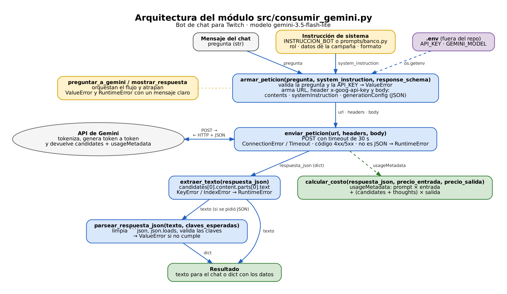

# 🎮 Bot de chat con IA para campañas en Twitch

Proyecto del Módulo 1 (Gate 1) de la Especialización en Desarrollo con IA Generativa.

La idea es un bot que lee el chat de un stream donde hay una campaña publicitaria, entiende qué tipo de mensaje es cada uno, responde las preguntas sobre el producto con los datos reales de la campaña y al final arma un resumen para la marca. En esta primera etapa construí la base: el módulo que habla con Gemini, los prompts y la elección del modelo.

## 📌 El problema

Cuando una marca pone un banner en un stream, lo único que sabe es que el banner salió. No sabe qué preguntó la gente en el chat, quién quería comprar ni qué dudas quedaron sin responder. Y en un chat que se mueve rápido, una pregunta tipo "¿cuánto cuesta?" se pierde entre memes y spam en segundos.

Responder a mano no escala, y poner un modelo de lenguaje a responder sin control tampoco sirve: en mis primeras pruebas, cuando no le daba los datos de la campaña, el modelo inventaba precios y descuentos que no existían. Por eso el bot solo puede usar los datos que le paso y, si no sabe algo, tiene que decirlo.

## 🏗️ Cómo está armado



El resto del proyecto usa una sola función, `consultar_modelo` (en `src/cliente.py`): le pasas el mensaje y te devuelve la respuesta, con los reintentos y el manejo de errores funcionando por dentro.

Por dentro, el consumo de la API está en `src/consumir_gemini.py`, separado en funciones chicas:

- `armar_peticion` valida el mensaje y arma la petición (con la instrucción de sistema y el esquema JSON cuando corresponde).
- `enviar_peticion` hace el POST con timeout y clasifica los errores: `ValueError` si la llave es inválida (eso no se arregla reintentando) y `TimeoutError` si es límite de uso, saturación o falta de conexión.
- `con_reintentos` vuelve a intentar solo ante un `TimeoutError`, esperando 2, 4 y 8 segundos.
- `extraer_texto` saca el texto de la respuesta.
- `parsear_respuesta_json` limpia el JSON y revisa que traiga las claves que espero.
- `calcular_costo` calcula cuánto costó la petición a partir de los tokens.

Los otros archivos:

- `prompts/banco.py`: los tres prompts del bot. `prompts/test_consistencia.py` los prueba contra la API.
- `src/comparar_modelos.py`: el script que usé para comparar modelos.
- `docs/decision-arquitectura.md`: por qué elegí el modelo que elegí.

### 📊 Qué modelo usé y por qué

Probé 9 modelos de Gemini con 8 mensajes de chat de ejemplo y medí la latencia 4 veces cada uno (20 de octubre de 2026). Estos fueron los que respondieron bien:

| Modelo | Latencia (mediana) | Costo por 10.000 mensajes | Clasificó bien |
| --- | --- | --- | --- |
| gemini-3.5-flash-lite (elegido) | 1,95 s | 1,32 USD | 8 de 8 |
| gemini-3.1-flash-lite | 6,31 s | 0,84 USD | 8 de 8 |
| gemini-3-flash-preview | 3,63 s | 12,65 USD | 8 de 8 |
| gemini-3.6-flash | 4,98 s | 24,94 USD | 8 de 8 |
| gemini-3.8-flash | 10,45 s | 24,20 USD | 8 de 8 |

Me quedé con `gemini-3.5-flash-lite`. El 3.1 es un poco más barato, pero tres veces más lento, y en un chat en vivo una respuesta que llega 6 segundos tarde ya no sirve. Los modelos más grandes no clasificaban mejor y costaban entre 10 y 19 veces más. El detalle está en `docs/decision-arquitectura.md`.

## ⚡ Instalación

Necesitas Python 3.12 o superior, Git y una API key de Gemini (es gratis, se saca en [Google AI Studio](https://aistudio.google.com/apikey)).

Ojo en Mac: `python3` a secas puede ser el Python 3.9 que viene con el sistema, y con ese las dependencias no se instalan (me pasó). Si no tienes 3.12: `brew install python@3.12`.

```bash
git clone https://github.com/Balgem/plantilla-repositorio-base.git
cd plantilla-repositorio-base

# Mac / Linux
python3.12 -m venv venv
source venv/bin/activate

# Windows (PowerShell)
py -3.12 -m venv venv
.\venv\Scripts\Activate.ps1

pip install -r requirements.txt
cp .env.example .env
```

Después abre el `.env` y pon tu llave:

```ini
API_KEY=tu_llave_de_gemini
GEMINI_MODEL=gemini-3.5-flash-lite
```

El `.env` está en el `.gitignore`, así que la llave nunca se sube al repo.

## 🚀 Cómo usarlo

Con el entorno activo:

```bash
python3 src/cliente.py
```

Debería salir algo así (el texto cambia un poco en cada corrida):

```text
--- Entrada vacía ---
Error de configuración: La pregunta no puede estar vacía.
--- Consulta normal ---
Santiago es la capital de Chile.
--- Mensajes del chat, con la instrucción del bot ---
> cuánto cuesta el teclado??
pregunta_producto | ¡Hola! El teclado mecánico K7 cuesta 59.990 CLP. Pídelo acá: https://ejemplo.cl/r/k7
> hacen envíos a regiones?
pregunta_producto | No tengo esa información, revisa el link https://ejemplo.cl/r/k7
```

El primer error es a propósito: muestra que el módulo rechaza un mensaje vacío antes de llamar a la API. Y el último caso es el que más me importaba: la campaña de ejemplo no dice nada de envíos, así que el bot no inventa y manda al link.

Con los prompts del banco la respuesta llega como JSON. Por ejemplo, para "hacen envíos a regiones?":

```json
{
  "respuesta": "No tengo información sobre envíos a regiones, te sugiero revisar el link https://ejemplo.cl/r/k7",
  "incluye_link": true,
  "dato_desconocido": true
}
```

### ⚠️ Lo que hace y lo que todavía no

Por ahora el bot clasifica mensajes, responde con los datos de la campaña, entrega JSON validado y calcula el costo de cada petición.

Lo que todavía no hace: no está conectado al chat real de Twitch, no guarda las interacciones en ningún lado y no tiene una API propia. Eso viene en los próximos gates.

## 🛡️ Errores

La idea es que el programa nunca se caiga con un traceback; cada error termina en un mensaje claro.

| Qué pasa | Dónde se maneja | Qué hace |
| --- | --- | --- |
| Mensaje vacío o falta la `API_KEY` | `armar_peticion` | `ValueError` antes de llamar a la API |
| Llave inválida (400 de llave inválida, 401, 403) | `enviar_peticion` | `ValueError` de inmediato, sin reintentar |
| Límite de uso, saturación (429, 5xx), sin internet o timeout | `enviar_peticion` + `con_reintentos` | `TimeoutError` y reintenta 3 veces |
| Se agotaron los reintentos | `consultar_modelo` | `RuntimeError: El servicio no respondió tras varios intentos.` |
| Respuesta sin texto o JSON mal formado | `extraer_texto`, `parsear_respuesta_json` | Error indicando qué faltó |

Los 503 fueron bastante frecuentes durante las pruebas, por eso agregué los reintentos. Un detalle que descubrí: con una llave inválida, Gemini no responde 401 sino 400 (`API_KEY_INVALID`), así que ese caso también se trata como error de credencial.

## 🗂️ Prompts

En `prompts/banco.py` hay tres prompts, cada uno con su esquema JSON:

1. `clasificar_mensaje`: decide si el mensaje es una pregunta del producto, interés de compra, spam u otra cosa, y si el bot debería responder.
2. `responder_viewer`: responde usando solo los datos de la campaña.
3. `resumir_chat`: resume un grupo de mensajes para el reporte a la marca.

Para probarlos:

```bash
python3 prompts/test_consistencia.py
```

Corre cada prompt 3 veces y guarda el resultado en `prompts/registro_resultados.json`. Los tres dieron 3 de 3 respuestas válidas.

Algo que aprendí acá: si se le deja, el modelo también le hace publicidad al spam. Por eso el clasificador decide primero si corresponde responder, y el bot solo contesta preguntas del producto o interés de compra.
