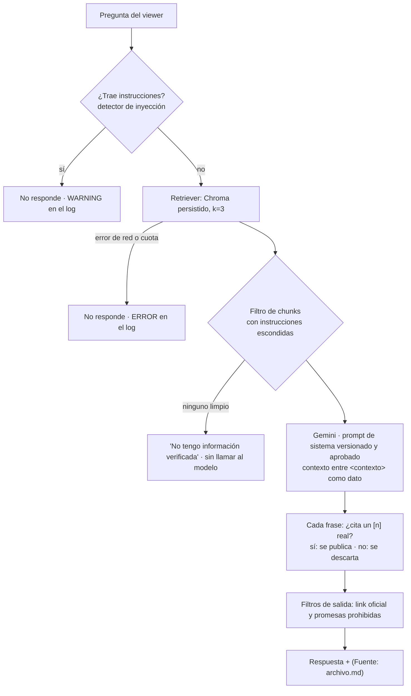

# 🎮 Bot de chat con IA para campañas en Twitch

Proyecto de la Especialización en Desarrollo con IA Generativa. **Gate 2: servicio IA modular con RAG.**

El bot lee el chat de un stream donde hay una campaña publicitaria (aquí, un teclado ficticio, el K7), responde las preguntas sobre el producto **solo con la información de la campaña y diciendo de dónde la sacó**, deja trazado todo lo que hace sin guardar datos personales, y al final arma un reporte para la marca que **no se envía hasta que una persona lo aprueba**.

## 📌 El problema

Cuando una marca pone un banner en un stream, lo único que sabe es que el banner salió. No sabe qué preguntó la gente, quién quería comprar ni qué dudas quedaron sin responder. Responder a mano no escala, y poner un modelo a responder sin control tampoco sirve: en mis primeras pruebas inventaba precios, descuentos y links (3 de 3 corridas inventaron el link de compra). Por eso cada respuesta del bot tiene que salir de un documento de la campaña y citarlo, y si la información no está, el bot lo dice.

---

## ⚡ Inicio rápido (entorno limpio)

Necesitas **Python 3.12 o superior** (las versiones fijadas en `requirements.txt`, como numpy 2.5, no se instalan en 3.11: lo comprobé en el ensayo de entorno limpio), Git y una clave de Gemini (gratis en [Google AI Studio](https://aistudio.google.com/apikey)). En Mac, `python3` a secas puede ser el 3.9 del sistema: si no tienes uno más nuevo, `brew install python@3.12`.

```bash
git clone https://github.com/Balgem/plantilla-repositorio-base.git
cd plantilla-repositorio-base
python3.12 -m venv venv
source venv/bin/activate            # Windows: .\venv\Scripts\Activate.ps1
pip install -r requirements.txt
cp .env.example .env                # y pon tu clave en GEMINI_API_KEY
```

El proyecto acepta la clave como `GEMINI_API_KEY` (el nombre del curso) o `API_KEY` (el que usé desde el Gate 1). El `.env` está en `.gitignore`.

```bash
python3 main.py verificar           # Python, librerías, clave, .env ignorado e índice
python3 main.py servicio            # el servicio de punta a punta (crea el índice si no existe)
python3 main.py gate2               # las 4 pruebas de los criterios no compensables
python3 main.py pruebas             # todas las pruebas del proyecto (sin API, unos 3 segundos)
```

**Sin clave**, todo se puede probar igual con embeddings y modelo simulados (la corrida queda marcada como `SIMULADO`): `python3 servicio_rag.py --simulado`.

El índice (`vectorstore/`) no está en el repositorio: la primera corrida del servicio lo crea (15 embeddings, unos segundos) y las siguientes lo reutilizan sin recalcular nada. Si editas un documento del corpus, solo se vuelven a calcular los chunks que cambiaron.

### Qué se ve al correr el servicio

Cada respuesta sale con su fuente, su `trace_id` y la auditoría de esa consulta (un evento por etapa, sin el texto del viewer). Ejemplo del formato (los valores cambian en cada corrida):

```json
{
  "trace_id": "trace-11bce25a",
  "respuesta": "El despacho cuesta 3.990 CLP y llega a todo Chile. (Fuente: 03_despacho.md)",
  "fuentes": ["03_despacho.md"],
  "auditoria": [
    {"evento": "consulta_recibida", "pregunta_len": 28, "pregunta_huella": "7f73e380b78f", "pregunta_pii": [], "prompt_huella": "959478c666ac"},
    {"evento": "documentos_recuperados", "n": 3, "ids": ["03_despacho.md#0", "03_despacho.md#1", "02_precio_y_compra.md#0"]},
    {"evento": "contexto_filtrado", "n_limpios": 3, "n_descartados": 0},
    {"evento": "consumo_llm", "input_tokens": 324, "output_tokens": 15, "costo_usd": 0.0001347},
    {"evento": "respuesta_generada", "fuentes": ["03_despacho.md"], "frases_sin_cita_quitadas": 0, "publicada": true}
  ]
}
```

Si la información no está en el corpus, la respuesta es `"No tengo ese dato del K7."`, sin fuente: es la única respuesta que se publica sin cita, porque no afirma nada.

---

## 🏗️ Cómo funciona una consulta



Todo eso deja eventos JSON en `logs/rag.jsonl` con el mismo `trace_id`. La pregunta queda como largo + huella HMAC + qué tipo de dato personal traía (`["correo"]`), nunca como texto.

Las otras piezas del bot:
- **Agente con herramientas y memoria por viewer** (`src/agente_con_herramientas.py`, `src/agente_con_memoria.py`): registra interesados en comprar y marca comentarios negativos. Su herramienta `consultar_campana` usa el mismo RAG, y si el modelo no copia la fuente en su respuesta, el código se la agrega.
- **Reporte a la marca** (`src/reporte_marca.py`): resume el stream desde las trazas y **se detiene** hasta que una persona decide.
- **Registro de versiones de los dos prompts de sistema** (`prompts/registro_versiones.json`): el del RAG y el del agente, con su historial real desde el Bloque 21. El bot usa la versión aprobada, y cada consulta deja en el log la huella del prompt que la respondió.
- **Viewers que intentan inyectar**: su mensaje no llega al agente, la traza lo marca con la huella del viewer, y la persona que aprueba el reporte los ve antes de enviarlo (a la marca solo le llega el número).
- **Clasificación con salida estructurada** (`with_structured_output` + el esquema `Clasificacion`): el paso 1 de la chain solo puede devolver una de las 4 categorías. Es la mejora que dejó la decisión del Bloque 30.

## 🚦 Los cuatro criterios no compensables

| Criterio | Cómo lo cumple | Prueba |
|---|---|---|
| **1. El pipeline corre de punta a punta sin excepciones** | Los errores de la API (embedding de la pregunta, modelo) se capturan y quedan en el log; el bot no responde en vez de caerse. `servicio_rag.py` termina con código 0. | `test_1` |
| **2. Cada respuesta cita su fuente** | La fuente sale de la **metadata del chunk recuperado**, no del texto del modelo. Una frase sin cita válida no se publica. | `test_2` (el modelo simulado escribe solo `[1]`: si la fuente aparece, la puso el código) |
| **3. Sin PII ni contenido crudo en los logs** | `src/privacidad.py`: huella HMAC con clave propia y redacción de correo, RUT, teléfono y links. Se aplica en logs, trazas del agente y avisos de los filtros. | `test_3` lee el **archivo** de log, no solo `caplog` (mis loggers no propagan) |
| **4. Supervisión humana real sobre la acción de mayor riesgo** | Enviar el reporte a la marca: grafo de LangGraph con `interrupt()` y checkpointer SQLite. Se detiene, una persona elige qué comentarios van y aprueba o rechaza; recién ahí se envía. | `test_4` |

```bash
python3 main.py gate2      # = python3 -m pytest test_gate2.py -v
```
Con `GATE2_REAL=1 python3 main.py gate2` las mismas pruebas corren contra el índice real y Gemini.

## 🛑 Supervisión humana

**Reporte a la marca** (la acción de mayor riesgo: comunica en nombre del canal y no se puede retirar):
```bash
python3 main.py reporte                                     # arma el reporte y se DETIENE
python3 main.py reporte --pendientes                        # qué espera una decisión (aunque hayas cerrado la terminal)
python3 main.py reporte --aprobar reporte-xxxxxxxx --comentarios c1,c3
python3 main.py reporte --rechazar reporte-xxxxxxxx
```

**Un prompt nuevo** (cambia el comportamiento de todas las respuestas):
```bash
python3 main.py supervision --proponer <huella>             # muestra el diff y se detiene
python3 main.py supervision --aprobar <thread_id> --huella <huella>
```

Solo `True` aprueba (en el grafo de la lección, `resume="no"` activaba la versión), el nodo que pregunta no tiene efectos (LangGraph lo vuelve a ejecutar al reanudar), y no se puede aprobar dos veces ni algo distinto de lo que se revisó. Las respuestas del chat en vivo **no** se aprueban una por una: no escala y llegarían tarde. Su red es el filtro de salida y la revisión posterior de lo que el bot frenó (`python3 main.py logs --revisar`).

## 📋 Evidencia por dimensión de la rúbrica

| Dimensión | Dónde está |
|---|---|
| **Pipeline RAG funcional (25 %)** | `servicio_rag.py`, `src/indexar_corpus.py` (índice persistido, actualización incremental con ids y huella del contenido), `src/logging_rag.py` |
| **Recuperación y citación (15 %)** | `src/evaluacion_recuperacion.py` sobre mi corpus: con k=3, precisión 0,333 (93 % de la máxima posible) y recall 0,962 (`docs/evaluaciones/`). Citas obligatorias en cada respuesta |
| **Costo, latencia y checklist (10 %)** | `src/registro_rag.py`, corrida real del 2026-11-16 en `docs/registros_latencia_costo.jsonl`: generación = 77 % del tiempo, ≈ 0,13 USD por 1.000 respuestas. Consumo por consulta en cada log |
| **Personalización justificada (15 %)** | `docs/decision_personalizacion.md`: con evidencia (20/20 aciertos del clasificador actual) la decisión es **no personalizar** |
| **Observabilidad y trazabilidad (15 %)** | Logs JSON con `trace_id` por consulta, consumo, huella del prompt y auditoría por respuesta (`src/logging_rag.py`) |
| **Seguridad, versionado y gobernanza (20 %)** | Inyección en 4 capas (`src/logging_rag.py`), versionado (`src/registro_prompts.py`), dos puntos de supervisión, `docs/matriz_riesgos.md`, `src/privacidad.py`, `docs/limites_autonomia_agente.md` |

El registro del ensayo funcional (qué encontré y qué corregí) está en `docs/registro_ensayo_gate2.md`, y mi autoevaluación en `docs/autoevaluacion_gate2.md`.

## 🧭 Comandos

Todo se corre desde `main.py` (`python3 main.py` muestra la lista completa; los argumentos que siguen al comando pasan al script):

| Comando | Qué hace |
|---|---|
| `servicio`, `consulta "..."` | El servicio RAG completo / una pregunta |
| `verificar`, `gate2`, `pruebas`, `autoevaluacion` | Entorno, criterios no compensables, todas las pruebas, autoevaluación |
| `indexar` (`--desde-cero`, `--verificar`) | Índice incremental |
| `recuperar`, `evaluar`, `registro` | Recuperación con citas, precisión/recall, latencia y costo |
| `dataset`, `decision` | Personalización (Bloques 29 y 30) |
| `logs` (`--real`, `--revisar`), `prompts`, `supervision`, `matriz` | Observabilidad, versionado, supervisión, riesgos |
| `agente`, `memoria`, `trazas`, `reporte` | Agente, memoria, trazas y reporte a la marca |
| `rafaga`, `pipeline`, `metricas`, `revision`, `chain`, `enrutamiento` | Componentes de las unidades 2.1 a 2.3 |
| `demo`, `consistencia`, `comparar --confirmar` | Gate 1 |

## 🧱 Decisiones principales

| Decisión | Por qué | Detalle |
|---|---|---|
| Modelo `gemini-3.5-flash-lite` | El más rápido de los que clasificaron 8/8 (1,95 s), a 1,32 USD por 10.000 mensajes | `docs/decision-arquitectura.md` |
| Chunks de 250 caracteres, un documento a la vez | Entra el párrafo más largo entero y un chunk nunca mezcla dos temas: 6 documentos → 15 chunks | `src/indexar_corpus.py` |
| k = 3 | Mejor F1 que k = 5 en mi conjunto de 15 casos | `docs/evaluaciones/` |
| No personalizar el modelo | El problema que justificaría PEFT (formato inconsistente) no apareció: 0/20 fallas | `docs/decision_personalizacion.md` |
| Prompt v3 (`959478c666ac`) | La v2 hacía decir al bot "el contexto no menciona…", y el viewer no sabe qué es "el contexto". Aprobada con el grafo de supervisión | `prompts/registro_versiones.json` |
| Fuente obligatoria por frase | Sin cita, una respuesta no se distingue de una alucinación | `armar_publicacion` en `src/logging_rag.py` |
| Prompt del agente versionado | Su cambio del Gate 2 entró sin aprobación: se registró como propuesta y se decide con el grafo, como cualquier otro | `python3 main.py prompts` |

## ⚠️ Lo que todavía no hace

- No está conectado al chat real de Twitch ni a un CRM: los viewers y el CRM son simulados.
- El detector de inyección se puede esquivar con sinónimos o separando letras (lo probé en el Bloque 31). Por eso no es la única capa: el filtro de salida y la cita obligatoria actúan aunque el detector falle.
- La generación tarda entre 2 y 9 segundos según la corrida: en un chat rápido, algunas respuestas pueden llegar tarde. Está medido, todavía no optimizado.

## 🗂️ Estructura

```
main.py                  punto de entrada único
servicio_rag.py          el servicio de punta a punta (Gate 2)
test_gate2.py            los 4 criterios no compensables
verificar_entorno.py     chequeo previo a la corrida final
corpus/campana_k7/       los 6 documentos de la campaña (ficticios)
prompts/                 banco de prompts (Gate 1) y registro de versiones del prompt del RAG
src/                     el código, un archivo por pieza (indexación, recuperación, logging, agente, supervisión...)
tests/                   pruebas unitarias, sin API (python3 main.py pruebas)
docs/                    decisiones, evaluaciones, matriz de riesgos, registros
```

## 🧪 Pruebas

```bash
python3 main.py pruebas     # = python3 -m pytest -q
```
Ninguna prueba llama a la API: el modelo y los embeddings se reemplazan por versiones falsas, y los archivos (logs, trazas, aprobaciones, checkpoints, la clave de las huellas) se escriben en carpetas temporales. Cubren desde el cliente del Gate 1 (errores, reintentos, costo) hasta los criterios del Gate 2 (fuentes, PII, supervisión).

---

## 📚 Gate 1: la base

El Gate 1 fue el cliente de Gemini (`src/consumir_gemini.py` y `src/cliente.py`): validación de la entrada, errores clasificados (`ValueError` si la clave es inválida, `TimeoutError` si es límite o saturación), reintentos con backoff exponencial y jitter solo cuando tiene sentido, y el costo de cada petición. Un detalle que descubrí ahí: con una clave inválida, Gemini no responde 401 sino 400 (`API_KEY_INVALID`).

Para elegir el modelo comparé 9 modelos de Gemini con 8 mensajes de chat y 4 mediciones de latencia cada uno (20 de octubre de 2026):

| Modelo | Latencia (mediana) | Costo por 10.000 mensajes | Clasificó bien |
| --- | --- | --- | --- |
| gemini-3.5-flash-lite (elegido) | 1,95 s | 1,32 USD | 8 de 8 |
| gemini-3.1-flash-lite | 6,31 s | 0,84 USD | 8 de 8 |
| gemini-3-flash-preview | 3,63 s | 12,65 USD | 8 de 8 |
| gemini-3.6-flash | 4,98 s | 24,94 USD | 8 de 8 |
| gemini-3.8-flash | 10,45 s | 24,20 USD | 8 de 8 |

El banco de prompts del Gate 1 (`prompts/banco.py`: clasificar, responder y resumir, cada uno con su esquema JSON) se prueba con `python3 main.py consistencia`.
