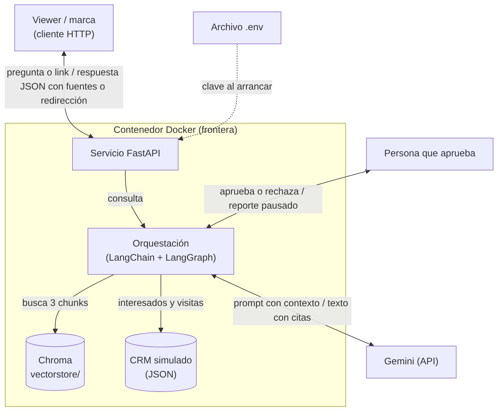

# Ficha de Diseño Funcional

Proyecto: bot de chat para campañas en Twitch (caso ficticio: el teclado K7, 59.990 CLP).

## 1. Problema de negocio

Una marca que patrocina streams de Twitch con una campaña (caso ficticio: el teclado K7) no puede medir su impacto: al terminar el stream solo sabe cuántas personas vieron el banner, no cuántas quisieron comprar ni cuántas llegaron al link de compra.

Mientras tanto, las preguntas sobre el producto las responde a mano el streamer o un moderador. En un stream de 2 horas llegan unas 40 (estimación: cerca del 3 % de unos 1.500 mensajes) y alrededor de la mitad queda sin respuesta o con datos equivocados.

Se espera que cada pregunta reciba una respuesta correcta, con la fuente del dato, en menos de 10 segundos, y que al terminar la marca reciba un resumen revisado por una persona con cuántos viewers mostraron interés y cuántos llegaron al link.

## 2. Requerimientos y alcance (MVP)

### Requerimientos funcionales
- RF-01: El servicio recibe una pregunta por HTTP y devuelve un JSON con la respuesta, las fuentes y un trace_id.
- RF-02: Cada respuesta indica el documento de la campaña del que sale el dato, o dice que no tiene ese dato.
- RF-03: Cuando un viewer muestra interés en comprar, queda registrado una sola vez en el CRM simulado.
- RF-04: Los comentarios negativos sobre el producto quedan marcados para el reporte.
- RF-05: El reporte de la campaña se envía a la marca solo después de que una persona lo aprueba.
- RF-06: Los mensajes que intentan cambiar las instrucciones del bot no se responden y quedan registrados.
- RF-07: El servicio procesa un archivo con el chat simulado de un stream completo.
- RF-08: El servicio lee el chat real de un stream de Twitch.
- RF-09: Un panel web muestra en vivo las preguntas, respuestas e interesados.
- RF-10: Cada viewer interesado recibe un link con su propio código; al abrirlo, la visita queda registrada y se redirige al link oficial de compra.
- RF-11: El servicio atiende varias campañas, cada una con sus propios documentos.

### Requerimientos no funcionales
- RNF-01: Responde en menos de 10 s en al menos 9 de 10 preguntas de prueba.
- RNF-02: En 10 preguntas de prueba que incluyen un correo, ningún log guarda la pregunta completa ni el correo.
- RNF-03: El servicio levanta desde cero en un contenedor siguiendo el README en menos de 10 minutos.
- RNF-04: El documento correcto está entre los 3 recuperados en al menos 12 de las 13 preguntas de evaluación que tienen respuesta.
- RNF-05: Cuesta menos de 0,50 USD por cada 1.000 respuestas.
- RNF-06: El índice se reconstruye desde cero con un comando en menos de 1 minuto.

### Alcance
Imprescindible: RF-01, RF-02, RF-03, RF-05, RF-10
Deseable: RF-04, RF-06, RF-07, RF-11
Fuera de alcance: RF-08 (necesita un stream en vivo y credenciales de Twitch; no se puede mostrar de forma confiable en la defensa), RF-09 (el programa no incluye una unidad de interfaz web)

El contenedor (RNF-03) también es parte del MVP: es una de las tres capas obligatorias del proyecto.

Revisé el alcance con `python3 main.py presupuesto` (`src/presupuesto_alcance.py`), contando solo las horas que faltan y con 1,5 veces las horas en lo que no he usado (FastAPI y Docker). Con 30 horas disponibles quedan 15 netas: los imprescindibles con el contenedor suman 14 y entran también RF-04 y RF-06, que ya están hechos. RF-07 y RF-11 entran solo si sobra tiempo. Con 20 horas el contenedor no cabe; en ese caso simplifico RF-10 antes que sacar el contenedor.

## 3. Arquitectura de la solución

Diagrama: `docs/diagrama_arquitectura.png`

- **Gemini (API)**: `gemini-3.5-flash-lite` para generar, porque fue el más rápido de los que clasificaron bien 8 de 8 en el Gate 1; `gemini-embedding-001` para los embeddings. La clave está en `.env` y nunca en el repositorio.
- **Chroma**: vector store local en `vectorstore/`, con actualización incremental (solo recalcula los chunks que cambian). Basta para 5 documentos y no necesita un servidor aparte.
- **Orquestación**: LangChain para recuperar (k = 3), filtrar instrucciones escondidas y generar con citas; LangGraph para el agente y para detener el reporte hasta que una persona lo aprueba.
- **Servicio FastAPI**: dos endpoints, uno de consulta (RF-01) y uno de redirección para los links medibles (RF-10). Los clientes pueden ser cualquier programa que hable HTTP.
- **Contenedor Docker**: empaqueta el servicio; la clave entra al arrancar desde `.env` y `vectorstore/` se monta como volumen para no recalcular el índice cada vez.
- **CRM simulado**: un archivo JSON con los interesados y las visitas a los links. Reemplaza al sistema real de la marca, que está fuera de alcance.

## 4. Criterios de aceptación
[PENDIENTE: se completa en el Bloque 34]

## 5. Plan de construcción por hitos
[PENDIENTE: se completa en el Bloque 34]
